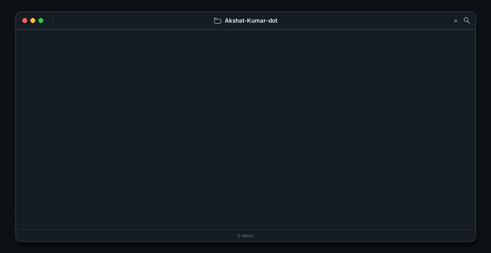

## Hi, I'm Akshat Kumar 👋

<!-- tree:projects -->
[rust-sketch](https://github.com/Akshat-Kumar-dot/rust-sketch) · [Abstract-Mind](https://github.com/Akshat-Kumar-dot/Abstract-Mind) · [PaddyWise](https://github.com/Akshat-Kumar-dot/PaddyWise)
<!-- /tree:projects -->

Tree design credit: <a href="https://x.com/FinnoTaylor/status/2112286571999428676">FinnoTaylor on X</a>, who made the original "literal file tree". This is my own version of the idea, drawn from my repos.
