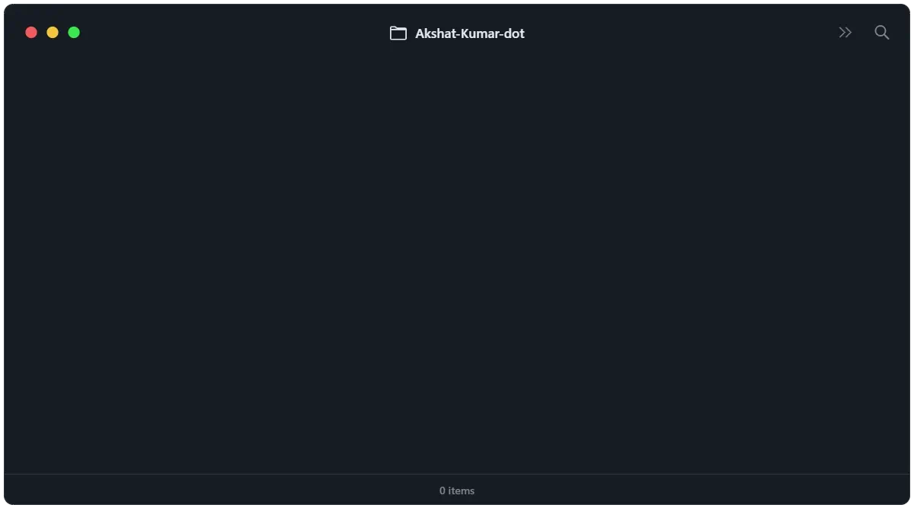

## Hi, I'm Akshat Kumar 👋
Software & AI developer from India · <a href="https://byakshat.in">byakshat.in</a>

<picture>
  <source srcset="literal-tree.avif" type="image/avif" />
  
</picture>

I build software and AI tools that show their work. My notes assistant links every sentence of an answer to the passage it came from, and my document reader marks which fields you should double-check before you trust them. If a tool can't back something up, it should say so.

### `~/projects`

<!-- tree:projects -->
<pre>
<a href="https://github.com/Akshat-Kumar-dot">Akshat-Kumar-dot</a>/
├── <a href="https://github.com/Akshat-Kumar-dot/Abstract-Mind">Abstract-Mind/</a>   reads a paper or a UPI receipt and fills the form for you
├── <a href="https://github.com/Akshat-Kumar-dot/Notes_Rag">Notes_Rag/</a>       answers only from your notes, every sentence cited
├── <a href="https://github.com/Akshat-Kumar-dot/Traffix">Traffix/</a>         a Q-learning traffic light vs the fixed timer, in SUMO
├── <a href="https://github.com/Akshat-Kumar-dot/geoexplore">geoexplore/</a>      ranks manganese exploration ground for MOIL (SIH 2026)
├── <a href="https://github.com/Akshat-Kumar-dot/PaddyWise">PaddyWise/</a>       paddy yield prediction, stacking model built in NumPy
└── README.md        you are here
</pre>
<!-- /tree:projects -->

### `~/highlights`

<table>
<tr>
<td width="33%" valign="top">

**[Notes_Rag](https://github.com/Akshat-Kumar-dot/Notes_Rag)** · [live ↗](https://notes-rag.akshat-kumar-singh05.workers.dev)

I kept pasting lecture notes into chatbots and getting answers that weren't in them. This one answers only from your own files, links every sentence to its passage, and says so when your notes don't cover the question.
</td>
<td width="33%" valign="top">

**[Abstract-Mind](https://github.com/Akshat-Kumar-dot/Abstract-Mind)**

Upload a research paper or a UPI receipt and get back the fields a form asks for: authors, affiliations, ORCID, amount, UTR. Each one is marked Verified, Check or Review, with the line it was read from. OCR runs on the server itself; no file leaves it.

</td>
<td width="33%" valign="top">

**[Traffix](https://github.com/Akshat-Kumar-dot/Traffix)**

Two real SUMO simulations on the same routes and seed: one on the junction's fixed timer, one driven live by a trained Q-learning agent. A control-room view plays them side by side, with live queues and wait times.

</td>
</tr>
</table>

### `~/stack`

### `~/now`

- Building [byakshat.in](https://byakshat.in), my portfolio: a desk at night, a notebook, two hands and a globe of projects, all drawn in the browser.
- Keeping this page alive: the tree at the top rebuilds itself from my repos every Monday.

### `~/contact`

[byakshat.in](https://byakshat.in) · [akshat.kumar.singh05@gmail.com](mailto:akshat.kumar.singh05@gmail.com)

Tree design credit: <a href="https://x.com/FinnoTaylor/status/2112286571999428676">FinnoTaylor on X</a>, who made the original "literal file tree". The banner recreates his animation, relabelled with my repos.
